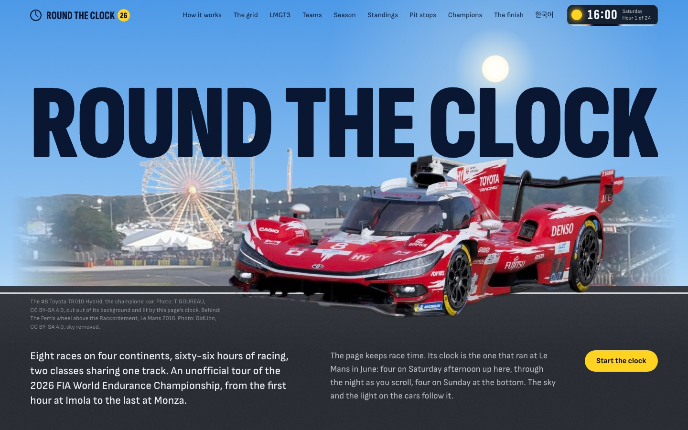
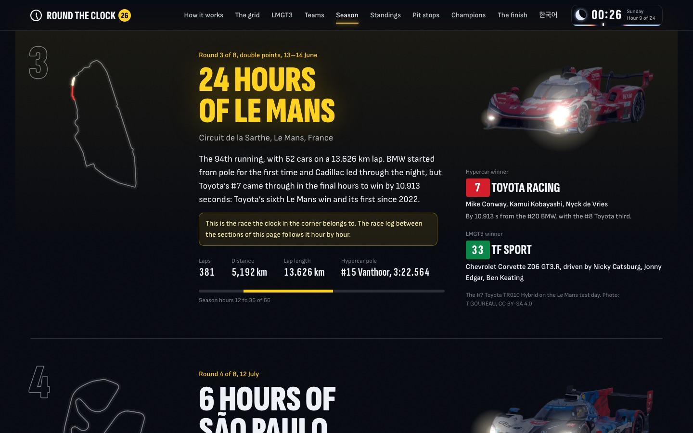
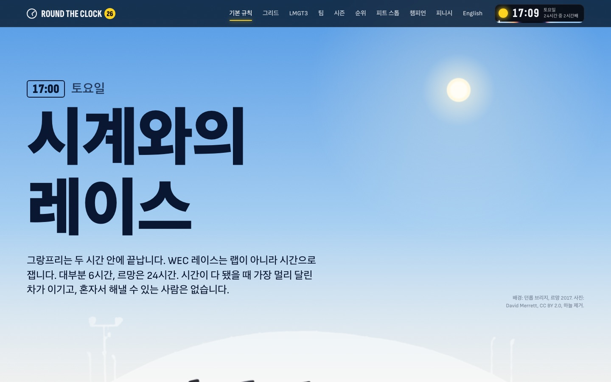

# Round the Clock 26

**Live:** https://round-the-clock-26.github.io/ · [한국어](https://round-the-clock-26.github.io/ko.html)



An unofficial tour of the 2026 FIA World Endurance Championship, told over the 24 hours of Le Mans. The page keeps race time: the clock in the corner starts at four on Saturday afternoon, runs through the night as you scroll and reaches four on Sunday at the bottom. The sky, the sun and moon, the light on the cars and the headlights all follow it.

Built as a front-end portfolio piece. Not affiliated with the FIA, the ACO, the FIA World Endurance Championship or any team.

## 외주 작업 / Work with me

DamianoX7이 외주 포트폴리오로 만든 비공식 팬 사이트입니다. 이 사이트에서 보여 드린 것처럼 이런 작업을 맡겨 주실 수 있습니다.

- 스크롤에 따라 장면이 바뀌는 브랜드·제품 소개 사이트
- 캠페인·행사용 랜딩 페이지
- 차트, 순위표, 지도로 데이터를 보여 주는 페이지
- 한국어·영어 두 언어 사이트
- 모바일 대응과 접근성(모션 줄이기, 화면 낭독기) 기본 포함

Built by DamianoX7 as a portfolio piece for freelance work: interactive brand and product sites, campaign landing pages, data-driven pages and bilingual Korean/English sites, mobile-ready and accessible by default.

## Highlights

- **A page that keeps time.** Scroll position is mapped to the race clock. Sky colours, sun and moon positions and the amount of starlight are keyframed by race hour and interpolated on every frame, then written to CSS custom properties.
- **Real photographs, relit.** Every car is a real photograph from the 2026 season, cut out of its background. A WebGL fragment shader darkens and tints it for the hour, adds a rim light, a contact shadow and, after dark, headlight halos and light pools on the road. Each car carries a small data map: depth for parallax, a mask for its lamps and one for glowing brake discs. Without WebGL it falls back to a 2D canvas.
- **Traffic, simulated.** An SVG map of the Circuit de la Sarthe with 62 cars in three classes lapping at their class winners' real average speeds, to show how often a Hypercar catches a GT car.
- **The season as data.** Eight round cards with circuit traces from OpenStreetMap, a standings board you can replay round by round, a step-by-step pit stop scene, records and the champions.
- **17 team pages** with their own colours: history, milestones, each car with its crew, a round-by-round results table and what defines the car.
- **Two languages.** The whole site, team pages included, is also in Korean (see below).
- **Driver portraits** for 72 drivers, all freely licensed photographs found through Wikidata.
- **Accessible by default.** `prefers-reduced-motion` turns the scroll effects off and shows end states, headings and charts have text alternatives, and there is a skip link and keyboard support for the tabs.

| | |
| --- | --- |
|  |  |

## Stack

Vanilla JavaScript built with Vite, CSS, SVG and WebGL. Lenis smooths scrolling, IntersectionObserver drives the reveals, and pages are addressed with plain hashes (`#teams`, `#team-ferrari`). The site is fully static: any folder on any static host works.

## What is in this repository

This repository holds the published site, plus the tools added after it was built:

```
index.html, assets/      the site (English): built JavaScript, CSS and fonts
ko.html, assets/app-ko.js  the Korean site, generated (see below)
cars/, data/, bd/, photos/ car cut-outs and their data maps, backdrops, full-frame photographs
drivers/                 driver portraits and their credits (credits.json)
assets/drivers.js        puts the portraits on the team pages and lists their credits
i18n/                    Korean translation and build scripts
scripts/                 fetch_driver_photos.py
```

The original, unbundled sources are not part of this repository.

### The Korean version

The English site exists only as a built bundle, so the Korean one is generated from it rather than translated in source:

1. `i18n/segments.py` walks the bundle and lists every static text segment of its template literals, by id.
2. `i18n/ko.txt` (main page) and `i18n/ko_teams.txt` (team pages) hold the Korean for each id, about 930 segments.
3. `i18n/build_ko.py` writes `assets/app-ko.js`. It refuses any translation that changes the HTML markup of a segment, so a translation can never break the page structure.
4. `i18n/make_ko_html.py` writes `ko.html` from `index.html` and adds Korean typography: Hangul is taller than the condensed Latin capitals the display sizes were tuned for, so headings get more line height on the Korean page.

```bash
python3 i18n/build_ko.py && python3 i18n/make_ko_html.py
```

### Driver portraits

`scripts/fetch_driver_photos.py` looks up every driver on Wikidata, keeps only items whose occupation is racing driver, takes their image (always a Wikimedia Commons file, so freely licensed), checks the licence and records the author. Photos that turned out not to be portraits are listed in the script and skipped. It is resumable and backs off when Wikimedia rate-limits it.

## Run it locally

```bash
python3 -m http.server 8000   # then open http://localhost:8000
```

## Credits

- Car and race photographs from Wikimedia Commons by T GOUREAU, GenericPerson32, Marcin Pultyn, MarcelX42, David Merrett, OldLion and Nic Redhead, under CC BY and CC BY-SA licences. The full list, with a link to each original, is at the foot of the site. Adapted CC BY-SA images are shared under the same licence.
- Driver portraits from Wikimedia Commons, each credited at the foot of the site.
- The Le Mans podium is Mike Conway's own Instagram post, shown through Instagram's embed.
- Circuit maps traced from OpenStreetMap data, © OpenStreetMap contributors, ODbL, via the Open Racetrack DB.
- Type: Sofia Sans and Sofia Sans Extra Condensed (SIL Open Font License). Smooth scrolling: Lenis (MIT).

Results and standings are final, as published after the 6 Hours of Monza on 8 November 2026. Team and car names belong to their owners.
